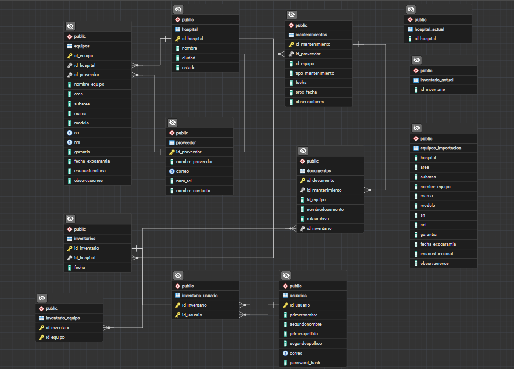

# DB_servicio-social_IMSS

## Descripción

Proyecto desarrollado durante el servicio social para la gestión e inventario de equipo médico hospitalario.

El objetivo es centralizar la información de hospitales, inventarios, usuarios participantes, equipos médicos, proveedores, mantenimientos y documentación asociada, permitiendo un control más eficiente de los recursos biomédicos.

---

## Objetivos

- Registrar hospitales y sus inventarios.
- Asociar usuarios participantes a cada inventario.
- Gestionar equipos médicos mediante NNI y número de serie.
- Registrar mantenimientos preventivos y correctivos.
- Gestionar proveedores externos.
- Asociar documentación a equipos, mantenimientos e inventarios.
- Implementar alertas para garantías y mantenimientos próximos.
- Servir como base para una futura aplicación web.

---

## Tecnologías utilizadas

- PostgreSQL
- pgAdmin
- Git
- GitHub

Tecnologías planeadas:

- FastAPI (Backend)
- HTML/CSS/Bootstrap o React (Frontend)
- OneDrive o almacenamiento externo para documentos

---

## Modelo de datos

Actualmente el sistema está compuesto por las siguientes entidades principales:

### Hospitales

Permite registrar los hospitales donde se realizan los inventarios.

### Inventarios

Representa cada proceso de inventario realizado en un hospital determinado.

### Usuarios

Personal participante en la realización de inventarios.

### Equipos

Registro maestro de equipo médico que incluye:

- Nombre del equipo
- Área
- Subárea
- Marca
- Modelo
- Número de serie (SN)
- Número Nacional de Inventario (NNI)
- Garantía
- Estado funcional

### Proveedores

Empresas externas encargadas de servicios y mantenimientos.

### Mantenimientos

Registro histórico de mantenimientos preventivos y correctivos.

### Documentos

Permite asociar documentos a:

- Equipos
- Mantenimientos
- Inventarios

---

## Flujo de inventario

### 1. Registro de hospital

Se registra el hospital donde se realizará el inventario.

### 2. Creación de inventario

Se crea un nuevo inventario asociado automáticamente al hospital activo.

### 3. Registro de participantes

Los usuarios son asociados al inventario mediante la tabla intermedia:

```text
inventario_usuario
```

### 4. Importación de equipos

Los equipos se importan desde un archivo CSV utilizando una tabla temporal.

```text
CSV
↓
Tabla temporal
↓
Validación
↓
Tabla equipos
```

### 5. Asociación automática

Mediante triggers:

- Se asigna el hospital correspondiente.
- Se vincula el equipo al inventario actual.
- Se registran las relaciones necesarias.

### 6. Generación de documentación

Se pueden asociar:

- Minutas
- Actas
- Reportes
- Manuales
- Garantías
- Reportes de mantenimiento

---

## Triggers implementados

### hospital_activo()

Actualiza automáticamente el hospital activo.

### inventario_hospital_actual()

Asigna el hospital activo al nuevo inventario.

### inventario_activo()

Actualiza el inventario actualmente en proceso.

### usuario_inventario_actual()

Asocia usuarios nuevos al inventario activo.

### equipo_inventario_hospital()

Asocia automáticamente equipos al inventario activo y al hospital correspondiente.

---

## Importación masiva de equipos

El sistema soporta la importación de inventarios completos mediante archivos CSV.

Proceso:

```text
Archivo CSV
↓
Tabla temporal
↓
Validación de datos
↓
Inserción en tabla principal
↓
Ejecución automática de triggers
```

Esta funcionalidad fue validada mediante pruebas con inventarios reales.

---

## Funcionalidades futuras

- API REST con FastAPI.
- Interfaz web para inventarios.
- Dashboard de indicadores.
- Alertas de mantenimientos próximos.
- Alertas de vencimiento de garantía.
- Exportación de inventarios a Excel.
- Generación de reportes PDF.
- Visualización de documentos desde la aplicación.

---

## Estado del proyecto

### Completado

- [x] Modelo relacional
- [x] Relaciones y claves foráneas
- [x] Triggers automáticos
- [x] Gestión de inventarios
- [x] Gestión de equipos
- [x] Gestión de usuarios
- [x] Gestión de proveedores
- [x] Gestión de mantenimientos
- [x] Gestión documental
- [x] Importación masiva mediante CSV

### En desarrollo

- [ ] Backend con FastAPI
- [ ] API REST
- [ ] Sistema de alertas
- [ ] Frontend
- [ ] Reportes PDF
- [ ] Exportación Excel

---

## Diagrama Entidad-Relación



---

## Autor

Luis Carlos Porras

Proyecto desarrollado durante el servicio social como propuesta para la gestión de inventarios y equipo médico hospitalario.
